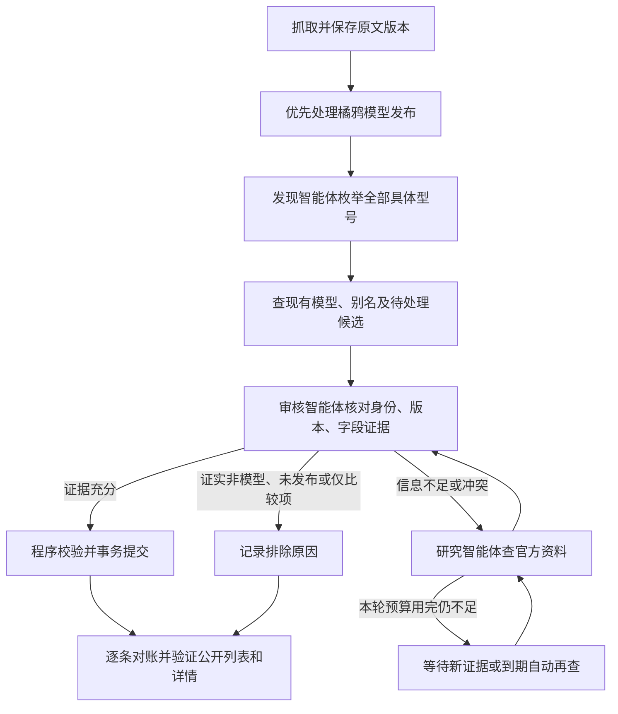

# 模型自动审核方案

2026-10-30，v3 设计完成，自动补证据与审核闭环尚未实现/上线。用户已确认：模型审核全部由智能体完成，不安排人工复核；橘鸦每天“模型发布”逐条优先核对；普通页面隐藏管理员入口，管理界面的后续交互暂缓。本轮并行修复系列版本校验、列表排序和完成状态，不能将这些修复描述为自动审核已经上线。

## 目标与完成标准

每一条发布报道必须有可追溯的处置清单：本次涉及哪些具体模型/尺寸/版本，各自对应哪个正式档案，更新了哪些字段，或者为什么排除。没有完整名称时，智能体沿原文链接补证据；参数、许可证、发布日期未知不阻止已确认身份的模型先建基础档案。不能为了清空队列编造字段、日期或型号。

范围包括新闻、Models Table 和后续资料变化引起的新增、更新、身份合并、排除与字段冲突审核。Models Table 可以先保存原始快照，但新增档案和变化字段同样提交审核智能体；内容未变的同步不重复审核。已入库历史记录不立即全量重审，有新证据或已知未解决问题时才进入任务。

“审核完成”必须是所有候选均已入库/关联或有证据排除，且原文中的版本数量与处置清单一致。程序返回成功、提取结果为空、JSON 合法、检查过原文，都不等于已收录。今天 ZwZ2 的“1 条来源、3 个版本”应对应三个模型 ID；Brush 没有确切发布日期，也必须能在最近更新列表中看见。

## 自动流程

以上是逻辑职责，继续使用现有 Python、DeepSeek SDK、collector 和 models worker，不引入多个独立服务或新的智能体框架。

1. **发现智能体**：新闻联合分析负责模型枚举。橘鸦模型发布走优先通道，先处理这一组再处理其他长文章，不等整批日报编排结束才入库。汇总系列拆成全部独立尺寸和 Base/Instruct 等版本；技术底座、榜单、工具、仅比较的旧型号排除。
2. **审核智能体**：每个新增/更新方案都经过审核，先使用同一套本地查询工具取得匹配档案和差异。简单案例批量审核，直接使用原文证据，不重复联网；返回 `create / update / link / exclude / need_evidence` 及对应证据。不能只给“置信度高”而不说明身份依据。
3. **研究智能体**：仅对缺口读取原文中的官方模型卡、发布说明、权重仓库和论文；仍不足才搜索。可以确认正式版本名、别名、发布日期或字段冲突。发布方没有公开的字段保持未知。不同尺寸、基础模型与微调版、同名不同机构分别核对，不按近似名称直接合并。
4. **提交程序**：验证引用确实来自保存的页面、目标 ID 存在、数值与日期有支持、内容版本未过期，随后用独立事务写模型、事件、来源关系及任务结果。失败回滚当前来源，其他来源继续。智能体不获得任意 SQL、终端、系统设置或密钥访问工具。
5. **对账程序**：按来源汇总已入库 ID、已关联、已排除及待证据数量；对橘鸦逐条比较枚举数量与最终结果，再经公开列表和详情接口验证可见性。已核对但未解决的来源显示“待补证据”，不显示全部收录完成。

## 没有人工复核队列

所有未解决的业务问题都有智能体任务负责。状态为 `queued → researching → reviewing → admitted / linked / excluded`，暂缺证据进入 `waiting_evidence`，服务故障进入 `blocked_service`。待证据不是等待用户点击批准，也不把无法核证的候选强行发布。

建议默认：证据不足在 30 分钟、2 小时、次日再查，最多三轮主动查询；仍无新证据转为监听新报道/官方内容变化，后续新证据自动唤醒。网络、限流和凭据故障按服务级退避；恢复后自动续接。凭据维护属于运行维护，不属于模型人工审核。

未命名线索或校验失败时可能没有 pending model ID，因此必须增加以 `(source_item_id, 内容指纹)` 唯一的来源核查任务。不能只扫描 `pending_models`，否则会再次遗漏今天这种“没有产生候选记录”的报道。已有 `ModelTask`、租约、检查点、查询和证据服务继续复用；来源任务记录其候选任务及最终模型 ID，重复投递不重复付费和入库。

现有人工锁定/排除的数据仍保留，不因切换自动审核而抹掉历史。新证据冲突由审核智能体继续核证；明确对应同一版本的官方勘误或后续变化，可由审核智能体生成带证据的更正决策，再经程序校验更新，不能以“人工曾锁定”为由永远等待人来解锁。对高风险的身份合并要求官方别名/同版本依据，无法确认则保持独立或等待证据。合并和字段更正均保留可追溯的前后值及来源，不能静默删除档案。

## 预算和运行默认值（设计建议，尚未启用）

| 项目 | 建议默认 |
| --- | --- |
| 思考与单次输出 | high，64K，总额度包含思考和答案；截断时减小批次 |
| 普通路径 | 复用联合分析，再进行一次批量审核；格式失败只修复失败项一次 |
| 每个来源每轮补证据 | 最多 6 次模型请求、3 次搜索、4 次页面读取，15 分钟总期限 |
| 每个来源每轮输出预算 | 累计 196,608 tokens，按已用量和剩余额度约束后续请求；不得在重试时重置账本 |
| 全站补证据预算 | 每日最多 30 个来源任务、累计 2,000,000 输出 tokens；橘鸦模型发布优先，余下任务次日或新证据到达后续接 |
| 并发与重试 | 单个 models worker；有限重试，保留已成功步骤；认证/配额问题暂停同服务请求 |

金额上限需要结合实际账单再定，此处不把 token 上限称为固定费用。来源原文和表格快照采集继续运行，审核额度耗尽的变更排队续接；不能跳过审核直接发布，也不停止整个站点。

新增发布自动审核和旧模型周期维护是两件事。实施时应单独启用新闻增量审核，不能直接把现有 `MODEL_AUTO_REVIEW_ENABLED` 改为 true 来恢复旧的全库/周期付费扫描。已完成结果不重写；优先接管现有未解决的橘鸦来源和有来源证据的待处理候选。

## 页面和接口

普通页面保留新闻、模型库、原文及助手，隐藏页脚“管理员入口”和模型库“模型审核”链接；查看公开原文档案时不露出管理导航。默认模型排序为最近收录/更新，发布日期仍可选，未知发布日期仍为空，不把新闻日期伪装成发布时间。

本轮只隐藏入口，现有受鉴权保护的直达管理页面和 API 暂时保留，登录、CSRF、写接口权限不变；隐藏链接不作为安全边界。后续如需要公开展示处理进度，使用只读“收录中/待证据/已入库”结果，不让用户处理审核任务，也不向公开页面暴露管理员按钮、密钥或思考正文。

## 实施顺序与验收

1. **本轮修复已上线**：ZwZ2 三个尺寸完整落库；Brush 等无发布日期的新档案能在首页找到；“待证据”准确计入结果；公开管理入口隐藏。隔离副本重复回放及本机 Edge 验收通过。2026-10-30 15:42（北京时间）服务器部署 `0abb894`，三条橘鸦来源对应五个正式档案，公开列表首页、详情和管理接口鉴权检查通过；补录零模型调用。此上线不包含第二阶段自动审核闭环。
2. **接通自动闭环**：来源级任务、增量审核入口、官方证据工具、审核决策、预算账本及唤醒策略；每个来源最终结果包含所有候选，不需要人工按钮。
3. **验收后上线**：用数据库副本和真实有限调用验证，覆盖系列尺寸、同名机构、别名、基础/微调版本、未来计划、未命名线索、来源断网、预算耗尽、重复执行和事务失败。重点验收橘鸦 3 条来源的 5 个模型，不以阶段 done 替代逐个模型检查。

当前运行 prompt 唯一来源仍是 `insight_agent.py::SYSTEM_PROMPT`、`model_discovery.py::PROMPT`、`model_research.py::PROMPT`、`model_review.py::PROMPT`。v3 实施时修改这些实际运行常量及工具 schema，并同步本文；本设计文档不是已经运行的 prompt。

2026-10-30 验证记录：本轮修复通过 184 项后端测试和 16 项相关前端测试，服务器副本及本机 Edge 验收通过。v3 的真实补证据调用、完整队列、自动审核与预算恢复测试须在第二阶段实现后执行，当前没有这些上线证据。
