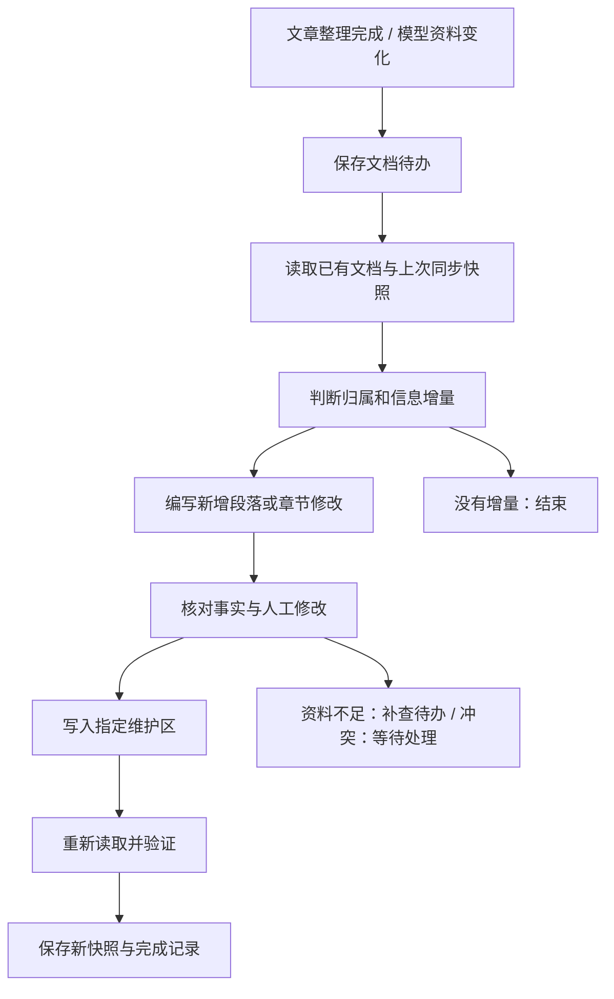

# i讯飞文档持续维护 Agent：设计方案

日期：2026-10-23。状态：待实现；本轮只形成方案，没有写入外部文档。

## 目标与接入边界

网站负责阅读资讯和查询模型，i讯飞文档负责保存可以长期查阅、补充笔记的个人知识。两者共用项目数据库中的已整理内容，文档中的个人笔记不自动回写为网站事实。

用户提供的目标位于 `xfchat.iflytek.com`。目前按“没有已确认可用的文档 API”设计。URL 中的 `/docx/` 不能证明兼容飞书接口。一次 `lark-cli` 只读尝试返回本地用户凭证缺失，在登录校验处终止，没有验证目标文档的读取权限或接口兼容性。

不把公开讯飞文档 SDK、飞书开放平台与当前 i讯飞租户当成同一套接口。内容维护逻辑与平台读写分开：若获得内部正式 API，则实现 API 通道；没有 API 时，先验证 Chrome 浏览器通道的读写能力。

## 文档如何组织

长期形态建议使用用户提供的新文档作为总目录，链接到以下内容。建立其他文档和目录前，需要确认实际创建能力与目标位置。

| 内容 | 作用 | 更新方式 |
| --- | --- | --- |
| 每日简报 | 按模型、工程、行业回看当日值得关注的进展 | 每天一篇；晚到资料更新同一天的简报，错误以更正说明保留时间线 |
| 模型档案 | 持续保存模型能力、规格、使用条件、版本变化与重要报道 | 同一个模型更新同一份档案，沿用项目模型 ID |
| 工程专题 | 积累 Agent、RAG、推理部署等方向的原理、方法、适用条件与实践入口 | 新信息归入已有主题；有实质增量时更新相关章节 |
| 行业追踪 | 按公司或主题积累发布、合作与市场变化 | 维护时间线，定期归纳变化；陈述与推断分开 |

总目录展示近期要点和导航，避免把所有全文永久堆在一篇文档里。首轮试点只在用户提供的文档内维护一小段明确的自动维护区，用少量日报和一个模型样例验证，再扩展为上述结构。

文档使用阅读型排版：标题、导语、必要的规格表、解释段落、关键图和少量延伸链接。来源链接融入相关段落或文末；队列、重试、审核原因留在网站内容管理页。

## Agent loop

1. **观察变化。** 收到数据库中已发布的文章、模型入库或已采用的资料更正。以实际内容的哈希判断变化；排除任务状态、检查时间等字段，避免每次复查都重写文档。
2. **读取上下文。** 找到对应日期、模型或主题的已有文档，读取相关章节及上次成功同步的快照。初期用数据库关联、标题与关键词定位，不引入向量数据库。
3. **决定是否维护。** DeepSeek 输出归属、增量内容、依据和拟修改的位置。重复报道可补充来源，但不再复制同一段正文；新规格、新的使用条件、已有结论的修正才更新档案。
4. **编写变更。** 复用已整理事实和正文，重组为适合长期查阅的内容。参数、日期等确定字段从已采用的模型资料取值。允许得出分析，但不能把推断写成已证实的规格。
5. **验证。** 检查涉及的实体、日期、引用、数字和目标区域。如果资料不足，生成有范围的补查任务；不能无限搜索，也不能为填满文档编造内容。现有模型研究流程可接收补查任务。
6. **发布并读回。** 程序执行文档修改，重新读取目标区域，检查内容、位置、链接和必要图片是否存在。只有读回验证成功才标记同步完成。
7. **等待下一次变化。** 正常任务到此结束；没有新内容时不调用模型。失败任务按限次退避重试，登录失效和内容冲突进入等待状态。

这是一个 DeepSeek 内容维护 Agent 配合确定性的任务执行器。创建文档、重试、定位和版本检查由程序处理，首版不拆成多个独立智能体。

## 触发时间

- 保持现有北京时间每天 10:00 的采集时间。
- 每轮资讯分析和正文编排完成后，提交该轮已完成内容对应的文档任务。文档更新不绑定死板的 10:05，不必等待所有模型联网研究结束。
- 模型之后完成补查，或用户采用资料更正时，单独提交受影响文档的更新任务。
- 同一目标文档的连续变化合并处理；执行期间又出现新变化，完成当前版本后继续处理新版本。
- 由后台定期对比内容哈希与最后成功同步的哈希，补上进程崩溃或旧数据导入产生的遗漏。
- 部分来源失败时，只发布已经整理完成的内容，显示实际更新时间，不声称已经覆盖当天全部资讯。
- 主题的每周综合分析作为后续功能；首版先验证每天的增量维护。

## 人工笔记与资料修正

每篇文档明确区分自动维护内容和个人笔记。首次建立维护区后，保存对应位置；可使用的平台块 ID、书签或稳定标题必须通过实际读取获得。

写入前比较三份内容：上次同步快照、当前远端内容、本次拟发布内容。人工区始终保留；自动区如果也被人工修改，不整篇覆盖，将这一部分的差异留待处理。其他互不冲突的内容可继续同步。

平台支持版本条件时按版本更新；浏览器通道不能保证原子版本检查，因此缩小每次修改范围，写前重新读、写后立即核对。无法可靠定位时停止这一项，不猜位置。

被人工移动、删除或取消共享的文档进入待处理状态，不自动重建副本。资料纠错同时更新长期档案并留下简短变更说明，日报保留当时记录及后续更正。

## 无 API 时的 Chrome 通道

服务端运行专用 Chrome 自动化会话，首次通过正常登录取得授权，并保护会话目录。使用清晰的读写操作和固定编辑步骤；不依赖 Agent 自由点击整页。Edge 可作为 Chrome 不可用时的备选。

先用实际文档验证以下能力，再确定自动维护的边界：

- 能否读取完整内容及稳定定位一个章节，页面是否分段或虚拟化加载。
- 能否在限定区域追加、修改并等待保存，刷新后是否仍存在。
- 能否上传图片、保留超链接和表格；能否创建其他文档并稳定取得链接。
- 登录在服务器环境中能否持续使用，是否有内网、单点登录或定期交互验证要求。

写入超时视为“结果不确定”，先重新读取核对，再决定是否重试。不得因为没有收到成功响应就再次追加整段内容。文档创建同理：恢复时先核对已创建的目标，不能盲目新建。

若只能稳定追加，首版只做按日归档和追加更正，不承诺自动改写长文档。若连可靠读回都无法实现，保留本地待发布稿，不把未确认上传的内容标记为成功。网页通道的长期稳定性必须通过试点验证。

日常运行遇到登录失效时保留任务、暂停外部写入，并在网站管理页显示需要重新登录。迁移到服务器时使用同一任务数据库和同步映射，避免重复创建历史文档。

## 原始资料与图片

文档档案保留官方介绍、论文、模型卡、代码仓库等资料入口。下载并归档 PDF 等原始附件可作为下一阶段能力；先做链接及来源登记，不自动搬运所有附件。

优先选择直接支撑正文的架构图、性能图和效果示例。现有网站图片来自原站外链，长期文档如果支持媒体上传，应上传可使用的图片并保存来源和文件哈希，避免重复上传及外链失效。未验证图片上传能力前，先保留资料链接，不用不相关封面补位。

## 对现有项目的最小改动

现有 `insights`、`models`、已采用的 `model_observations` 和关联报道是内容输入。未确认的模型更正不作为确定资料发布。

新增独立文档任务，不直接套用 `model_tasks`：后者绑定 `pending_id`，无法合理表示按天、按主题维护同一文档。沿用其持久队列、租约和检查点思路，首版只增加必要的文档流程。

| 记录 | 最小职责 |
| --- | --- |
| `document_bindings` | 本地日期/实体/主题与远端文档的对应关系；维护区域位置；最后成功发布的内容哈希、快照及远端版本（若可取得） |
| `document_jobs` | 目标与输入版本；待发布稿、差异及依据；执行阶段、重试、租约、结果不确定状态和验证记录 |

网站内容的发布或修改与文档待办在同一数据库事务保存，避免“网站已更新但文档任务丢失”。外部写入不能与本地数据库组成同一事务，需通过读回核对处理结果不确定的情况。由独立 document worker 处理外部写入，外部文档不可用时不阻塞网站采集和发布。同一远端文档按顺序执行，防止两个任务同时编辑。

建议模块是文档内容编排、文档任务执行和 i讯飞读写适配三部分；继续使用现有 FastAPI、SQLite 和 DeepSeek，不先引入新的消息队列或大型 Agent 框架。

网站的内容管理页增加目标文档链接、最近成功时间、待发布预览、失败重试和冲突处理。首页保持资讯阅读界面。

## 分阶段验收

第一阶段，验证接入和一小段维护区：能读、能保存、刷新后能读回；重复执行不会重复追加；人工笔记保持完整。

第二阶段，接入真实日报及模型增量：同日补充更新同一日报，同一模型补查更新同一档案；采集 10:00 开始、内容整理结束后发布；模型研究延迟不阻塞日报。

第三阶段，扩展工程与行业主题，以及资料附件：通过前两阶段后再增加目录、更多文档和周期性综合分析。

关键故障验收包括：写成功但确认失败、任务执行中重启、远端被人工修改、登录失效、图片失败、目标被删除，以及没有信息变化时零重复写入。

## 已查阅资料与不确定性

- [讯飞文档能力类型](https://open.iflydocs.com/docs/guide/sdktypes.html)：公开产品有不同接入形态，不能据此确定本租户接口。
- [讯飞文档在线文档 API](https://open.iflydocs.com/docs/openapi/api/doc.html)：公开接口展示了内容读写能力，当前目标尚未证实适用。
- [i讯飞域名下的云文档帮助](https://www.xfchat.iflytek.com/hc/zh-CN/articles/050365968090-%E4%BD%BF%E7%94%A8%E6%96%87%E6%A1%A3%E5%B7%A5%E5%85%B7%E6%A0%8F)：帮助内容包含飞书编辑器的块与工具栏说明，但 UI 来源不能证明开放 API 互通。

接入路径以用户实际部署环境和实测为准。当前未完成目标文档的读取、写入或服务器登录验证。
