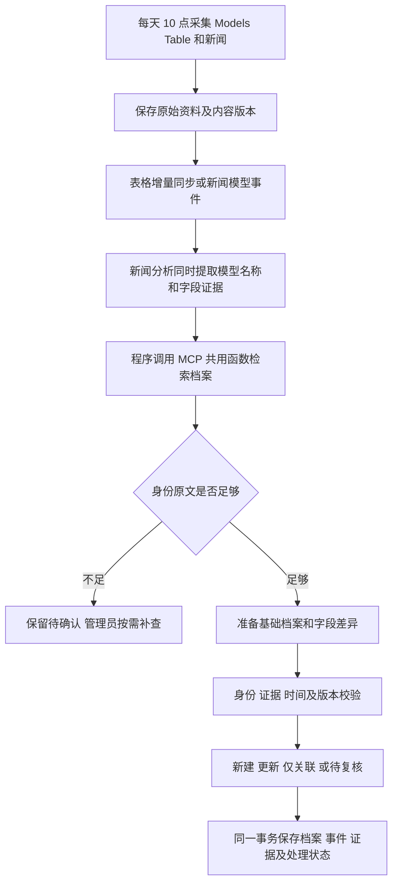

# 模型收录与信源维护 Agent 设计

日期：2026-10-30。状态：v2.2 事务与截断恢复已通过服务器真实任务验收；v2.3 新闻分析、编排和模型补提取提高至 64K 输出/600 秒，本机实现、待部署。后台 high 思考持续开启，后台登录后视觉验收待完成。当前自动流程以下述描述和[使用说明](model-agent-v1.md)为准；受控 MCP 写入、通用信源诊断 Agent 和框架迁移仍是设计目标。

模型库继续以 Models Table 为主要来源，每天北京时间 10 点增量采集。新闻分析的一次调用同时提取全部主体模型及字段证据；程序使用 MCP 共用查询服务查库，新模型直接建基础档案，已有模型只融合新增证据。不再为正常收录逐个运行联网研究与审核。名称或身份不清时保留待确认；未知参数和许可证留空。

发布前修订（2026-10-29）：来源独立校验与保存，补提取只重试失败项一次；机构中英文名及人工核实的模型别名统一检索；未来开放计划不作为当前可用状态。具体修复、残留线索和迁移边界以[发布前整理](release-readiness-2026-10-29.md)为准。

信源维护采用独立的工具权限和任务入口，复用现有 worker 与管理员后台。第一版无需增加多智能体对话、向量数据库或新的分布式调度系统。

## 第一版实施前的基础和缺口（历史记录，非当前流程）

| 环节 | 当前行为 | 需要调整的地方 |
| --- | --- | --- |
| 新闻匹配 | `insight_models.model_lookup` 按清洗后的名称、全名及表格名称匹配 | 检索需结合机构、别名、具体版本和官方标识；名称近似只用于找候选 |
| 表内模型 | `queue_model_drafts` 对 Models Table 已收录模型通常只关联新闻 | 允许新事件触发有针对性的资料更新，同时保留表格同步的低成本批处理 |
| 补查顺序 | `research_model` 先做联网搜索；审核时再传入整个模型库的简略列表 | 先检索并读取相关档案，有证据缺口才联网，避免重复搜索与过大的上下文 |
| 最终查重 | `model_review.find_existing` 按名称返回首个匹配模型 | 写入前统一复核身份，不能以同名首条记录决定合并 |
| 字段融合 | `record_research` 自动补空值，已有值发生变化通常进入冲突审核 | 区分“后续状态变化”和“互相矛盾的资料”，减少正常更新被卡住 |
| 任务恢复 | 已有持久队列、租约、心跳、研究检查点与重试 | 复用这些能力，增加身份决策、工具执行记录和可解释的处置结果 |
| 信源故障 | `source_fetch` 有有限重试、校验缓存和状态记录 | 增加故障分类、按来源暂停请求、诊断与恢复验证，避免重复触发相同错误 |

Models Table 同步的字段归属记录 `applied_values` 能保护其他途径修订过的值，第一版继续保留。实施前 `adopt_pending` 会结束某些非手动任务；第一版已区分“表格发现已完成”和“新闻新事件仍待处理”，防止新补查任务被提前结束。

## 模型维护的处理流程

调度器保证任务启动和失败恢复；普通收录由程序强制本地检索，再校验引用和身份，不要求额外 LLM 工具轮次。手动补查才使用可联网的 Agent。新建操作附带本次检索记录，不能仅依赖提示词要求“先查再写”。

2026-10-30 修订：每条来源在独立 Session 中先执行 `BEGIN IMMEDIATE` 再查询和写入，失败关闭事务后另行保存错误；一条失败不撤销已完成来源。新闻分析与编排输出截断时逐级缩小批次，单条失败仍继续后续批次。随后按用户要求，新闻分析、编排和模型补提取总输出上限提高到 64K、请求超时 600 秒，思考保持 high。预算、回归案例和线上状态见[故障修复记录](model-admission-recovery-2026-10-30.md)。

2026-10-29 已确认的成本边界：默认关闭历史全量扫描和周期补查；同一条新闻的结构化结果直接复用。旧来源缺少提取或校验失败才以每批 6 条补提取，最多一次修复；按指纹保存结果，重复执行零额外调用。橘鸦栏目、候选与未命名线索分别保留，后台对账不会把“任务执行结束”等同于“全部模型已入库”。详见[本次审查](model-admission-audit-2026-10-29.md)。

每条原始新闻保留正文、链接、发布时间、抓取时间和内容版本。只处理新增或实质变化的内容；排版变化、重复投递和任务重试不应重复创建模型。汇总文章可以作为入口，判断依据要能回到原文，防止整理过程遗漏新事实。

一次任务允许返回多项处置，一篇同时介绍多个模型或多个事件的报道不能只保留第一项。检索覆盖正式模型、别名和待确认记录；原来人工否决的候选可记录新证据，但不能无条件重新自动入库。

## 先确认模型身份

检索先使用已验证的官方标识和机构范围内的别名，再用名称、版本、参数规模、用途与模态找候选。当前数据量可以使用 SQLite 查询和全文检索，首版无需向量库。即使之后引入向量检索，相似度也只用于找候选。

身份核对必须保留版本区别，例如 Base 与 Instruct、7B 与 32B，以及不同发布日期的正式版本。官方仓库也可能同时承载多个尺寸或修订，仓库 URL 相同不能单独证明是同一个模型。

Agent 的处置结果统一为：

| 结果 | 行为 |
| --- | --- |
| 新模型或独立新版本 | 身份证据通过校验后创建记录；需要时关联同系列或基础模型 |
| 已有模型有新增事实 | 保留模型 ID，提交新增事件和字段差异 |
| 已有模型但没有新事实 | 关联新报道；不重复生成事件、不重复补查 |
| 身份存在歧义 | 保存候选、证据和具体疑点，在管理员后台复核 |
| 非模型信息 | 仍保留新闻，记录不进入模型库的原因 |

“没有检索到”不是新建的充分条件。新建前要确认机构和具体版本，写入事务内再次检查已验证身份，处理两条新闻同时发现同一模型的情况。身份尚不确定时可保存待确认记录，缺少参数量或许可证本身不构成拒绝收录理由。

## 把模型档案和后续事件分开保存

例如模型 A 首次公布时没有权重，一个月后开放权重，再后来开放 API。应保留同一个模型 ID，依次增加“公布”“开放权重”“API 可用”事件，更新对应状态。后来的日期不会覆盖最早公布日期，也不会把开放权重直接解释为采用某种开源许可证。

事件至少区分首次公布、权重开放、代码发布、API 上线或下线、许可证调整、能力或评测更新。新闻说“开源”时，需要进一步确认开放的是代码、权重还是两者，以及许可证具体适用范围。

字段采用以下规则：

| 情形 | 写入规则 |
| --- | --- |
| 字段为空，取得对应版本的明确证据 | 自动补充，保留来源与原文摘录 |
| 字段值相同 | 关联新证据；重复证据不生成重复记录 |
| 官方确认的后续状态变化 | 身份一致、适用范围明确、事件时间可排序时自动更新，并保留旧状态及生效时间 |
| 参数量、架构等资料互相矛盾 | 保存更正建议，标明各自口径，等待复核 |
| 人工确认过的字段 | 普通自动补查不能覆盖；新的变化或冲突进入复核 |
| 旧报道晚到 | 可补充历史事件；不把当前状态回退为旧状态 |
| 仅发现网页或仓库更新时间 | 不能据此更改公布日期或开放日期 |

区分事件发生时间、新闻发布时间与系统发现时间；只知道月份时保留月份精度，不能编造具体日期。后续状态变化需要证据和时间校验，不能简单采用“抓取时间最新者优先”。

现有 `AIModel` 继续保存当前档案，`ModelObservation` 继续保存字段证据和更正，`ModelInsight` 继续关联报道。新增必要的身份别名和模型事件记录；证据增加原文快照引用、内容指纹、适用版本及事件时间。人工确认的字段需有明确标记，不能只从当前值推测。

重复报道关联到同一事件，并保留每个来源的新增事实。事件合并采用“模型身份、事件类型、官方标识或有依据的发生时间”核对；不能只因“同一天、同类型”就合并不同进展。

## 给主模型使用的工具与 MCP

数据库查询和变更校验放在同一个 Python 业务服务层。网站 API、后台 Agent 和 MCP 都调用它，避免三套查重及融合规则。后台同进程调用可直接使用函数工具，其他主模型通过 MCP 调用同样的能力。

第一版工具如下：

| 工具 | 返回或执行的内容 | 权限 |
| --- | --- | --- |
| `search_models` | 按名称、机构、模态和身份标识检索；返回候选、匹配依据、歧义和分页信息，可包含待确认记录 | 只读 |
| `get_model` | 当前字段、别名、官方链接、事件时间线、未解决冲突与档案版本号 | 只读 |
| `get_evidence` | 指定字段或事件的原文摘录、来源、时间和快照标识 | 只读 |
| `get_source_health` | 脱敏后的错误类型、最近成功、缓存年龄和已尝试恢复动作 | 运维只读 |
| `request_model_update` | 根据新闻或证据标识提交维护任务，立即返回任务 ID | 受控写入 |
| `get_task_status` | 查看处置结果、变更差异或具体阻塞原因 | 按任务权限读取 |
| `submit_model_change` | 提交新建、更新或仅关联方案，经过程序校验后自动应用或进入复核 | 内部 Agent 使用 |

外部主模型默认只获得查询工具；需要触发维护时再授予对应写入范围。`submit_model_change` 不暴露任意 SQL，也不接受任意字段修改。它必须带事件标识、检索记录、证据引用、预期档案版本和幂等标识。校验与写入在同一事务中完成；发现档案被其他任务更新，则重新读取后再判断。

工具处理网页链接时校验目标及重定向，拒绝内网和本地资源。凭据只由请求执行器读取，工具结果和日志去除 token、认证头及含密钥的查询参数。正文作为不可信资料处理，不能改变 Agent 的工具权限。

远程部署使用 MCP 的 Streamable HTTP，并校验调用方身份和权限；本机接入可用 stdio。MCP 提供工具连接方式，模型身份判断、去重、事务与证据校验仍由本项目实现。[MCP 架构](https://modelcontextprotocol.io/docs/learn/architecture) · [Python SDK 部署](https://py.sdk.modelcontextprotocol.io/run/)

## 信源故障的诊断与恢复

普通重试先由规则执行，重试失败或出现新的错误类型再启动诊断 Agent。诊断任务按“来源和故障类别”合并，同一个搜索服务返回 401 时只处理一次服务故障，避免每个模型任务重复调用失效接口。

| 故障 | 自动动作 | 需要保留或升级处理的内容 |
| --- | --- | --- |
| 超时、连接中断、5xx | 有上限的退避重试；使用已验证缓存，或切换已配置且已验证的同源备用入口 | 显示缓存时间，缓存不能标为本次采集成功 |
| 429 | 遵守 Retry-After，降低该来源请求频率，安排下次尝试 | 记录恢复时间；其他来源继续采集 |
| 401 或明确的权限失败 | 暂停同服务的后续付费请求，核对端点、认证方式和凭据是否配置；保留脱敏诊断 | 需要更新凭据或服务授权时在后台提示；不能猜测或更改密钥 |
| 403 | 结合响应内容区分权限、访问限制或拦截页 | 无法区分时保持待诊断，不自动绕过限制 |
| 404 或地址迁移 | 检查重定向和已知官方网站入口，生成候选地址并验证内容身份 | 预先配置的备用地址可自动切换；新增来源或域名由管理员确认 |
| RSS、CSV 结构变化 | 保存失败样本，试用已有且经过测试的兼容解析器，比较字段及条目数量 | 新解析器修改先形成补丁与测试样本，验证后部署 |
| DNS、代理、证书问题 | 对配置中的目标进行有限连通性检查，给出错误证据 | 不自动关闭 TLS 校验或修改系统网络配置 |

恢复成功必须同时满足请求成功、解析通过、来源身份正确、关键字段完整、数量变化合理。HTTP 200 但返回登录页、拦截页或空内容不算恢复。恢复后的第一批数据通过既有去重流程重放，保留故障期间的处理进度。

Agent 可以调用受限的连通性检查、解析验证和已配置恢复动作；生产容器不提供通用 shell、自改代码或重启整台服务器的权限。需要修改代码的故障输出具体样本、原因和修复建议，进入代码测试及部署流程。模型服务本身不可用时，规则重试、缓存和管理员告警仍能工作。

## 服务器运行方式与成本

保留网页服务、采集 worker、模型 worker 的现有部署方式。两个 Agent 是不同任务类型及工具权限，初期可以运行在现有 worker 内，无需各自部署一套服务。

10 点采集保存原文后，联合分析、模型收录对账、新闻正文编排依次执行；模型入库不再等待正文编排结束。单个阶段失败保留状态，其他阶段和来源仍可继续。手动补查在独立 models worker 执行；自动周期补查默认关闭。RSS 已滚出窗口的资料不能声称完整补齐。

模型任务复用现有租约和检查点，在身份核对、证据获取及提交变更后记录阶段。数据库落库、证据关联和任务完成标记保持事务一致。进程在写入后崩溃、任务重复投递或两个来源同时报道，也不能重复新增模型。

普通收录不联网搜索，复用新闻分析的一次调用；新增发布候选不会逐个排付费任务。手动补查保留最多 3 次搜索、4 次正文读取、3 轮工具决策和 15 分钟限制，研究检查点可复用。精细的跨重试累计 token 账本仍是后续目标，不把工具上限等同于 token 总预算。

## 框架选择

当前决定保留 Python 服务、现有 SDK 与队列，先解决不必要的调用和身份校验。Pydantic AI 仅保留为后续可评估的调用层，不作为 v2 收录的前置条件。[Agent 文档](https://pydantic.dev/docs/ai/core-concepts/agent/) · [DeepSeek 接入](https://pydantic.dev/docs/ai/models/deepseek/)

Pi 的 agent core 提供工具执行和事件流，官方示例使用 TypeScript 与 npm。它可以实现这个流程，但当前项目接入会增加 Node 运行时或服务间通信；就本项目而言，收益暂不足以支持迁移主要业务逻辑。[Pi agent core](https://raw.githubusercontent.com/badlogic/pi-mono/main/packages/agent/README.md)

第一阶段先抽出共用的检索和变更服务，现有 SDK 也能调用这些工具。使用历史案例比较后，再决定是否用 Pydantic AI 替换当前手写循环。框架只负责调用编排，模型身份规则和数据可靠性留在业务层。MCP 使用官方 Python SDK；实现时锁定兼容版本，验证与现有依赖及部署方式兼容，不直接引入文档中的全部扩展组件。

## 管理员界面需要展示的结果

每次处理给出一句可核对的结果，例如“模型 A 已存在，新增开放权重事件，补充许可证；未创建新模型”。详情展示候选匹配依据、字段前后值、证据链接与原文、工具调用和处置原因。只保存这些可审计结果，不要求记录模型的内部思考过程。

管理员能够确认身份歧义、接受或驳回更正、锁定人工修订字段，以及重试失败步骤。撤销一次错误更新时保留原始证据和操作记录；已有后续更新的字段需要重新核对，不能整条档案直接回滚。

## 分阶段实施与验收

1. 实现统一检索、身份核对和变更校验，先以现有数据副本回放历史案例，比较当前流程和新流程的判断。
2. 接通新闻触发的模型 Agent，支持 Models Table 内外模型的后续事件；提供只读 MCP，再接入受控维护请求。
3. 增加信源故障分类和诊断工具，先开放有限重试、已配置备用入口和缓存恢复，逐步覆盖更多故障。

首批验收覆盖：

- 已有模型后续开放权重：模型数不变，新增一个事件，保留首次公布日期。
- 两个来源重复报道：模型及事件不重复，来源和各自的新增事实都保留。
- 同名不同机构、不同尺寸或 Base/Instruct：不误合并；无法确定时进入复核。
- 中英文别名或名称写法不同：取得机构和版本依据后正确关联。
- 同一仓库包含多个模型：不会只根据仓库 URL 合并。
- 旧报道晚到、日期只有月份：不回退当前状态，不制造日级日期。
- 新闻和 Models Table 同时更新：使用同一模型身份，表格同步不取消新闻事件任务，不覆盖人工确认值。
- 任务重复投递、执行中断和并发更新：不重复入库，不丢失来源或证据。
- 搜索服务返回 401：按服务暂停请求，模型任务保留为受阻状态；其他可用来源继续采集。
- RSS 返回 200 但内容为空或解析字段缺失：不标记恢复、不清空历史内容。

评估记录错误合并、新增重复、遗漏事件、待复核比例、每个有效更新的调用成本和恢复耗时。先运行只生成变更方案的观察模式；样例通过且误合并风险可接受后，再开启满足上述规则的自动写入。框架替换需要通过同一套案例，不能仅以“接口调用成功”作为验收。
