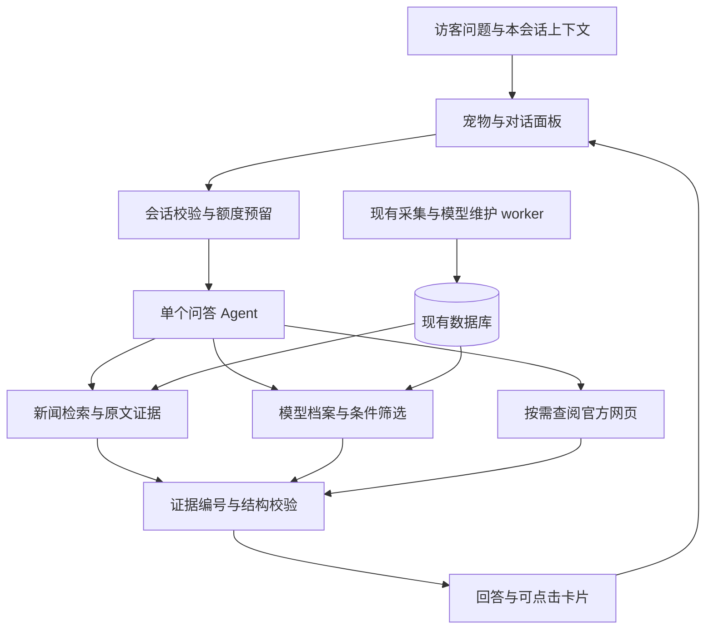

# 网站宠物助手设计

设计与运行版本：0.6。更新日期：2026-10-29。Windows 本机已实现九段可灵透明视频、六段随机待机队列与原拖拽互动；用户指定基础待机约 10 秒。服务器尚未部署。运行及验收记录见 [第一版使用说明](pet-agent-v1.md)。

本轮视觉方向：沿用用户提供的冷色仓鼠 `tuntun-cool.svg`，让角色有轻巧、可触碰的存在感，对话面板沿用网站明暗主题。内容顺序为角色与互动入口、问题、结论和证据。交互采用拖动搬位置、双击摸头、菜单点播小动作；发送问题后工作动画持续到处理结束，阶段文字仍反映真实进度，遵循减少动画设置。

为现有 AI 情报网站增加一个原创小仓鼠助手，帮助访客查询新闻、比较模型、选择部署候选，也能简短闲聊。第一版采用现有网页和 FastAPI 后端，加一个受限的工具调用 Agent。宠物负责交互与状态表达，检索结果和证据决定回答内容。

已确认：向网站访问者开放，设置使用额度；用户选择原创小仓鼠，角色本身采用冷色暗色系，适配黑色网页。机器人和暖奶油配色方案已放弃。界面以“囤囤”作为第一版名字，明暗主题跟随网站，命名及造型细节仍可调整。首版功能为文字对话，不包含语音、上传文件、桌面程序或浏览器扩展。

相关文档：[参考项目分析](dsh-pet-research.md)、[固定系统提示词](pet-agent-system-prompt.md)、[功能迭代流程](feature-development-workflow.md)。v0.4–v0.6 只迭代前端互动与素材，下文接口、固定 prompt 和默认额度沿用 v0.3；未完成的服务器验收单独标注。

## 用户交互

桌面网页初始右下角使用 120 像素画布显示角色（可见角色略小），双击角色摸头，“聊一聊”展开 408 像素宽面板。移动端角色画布 78 像素，快速轻点两下也可摸头。两次点击默认间隔不超过 400ms、距离不超过 24px；单击不启动或打断动作，Enter/空格或菜单可单次激活。拖动角色或面板标题栏整体移动，超过 6px 才认定拖拽并中断互动，松手不误触摸头；拖拽、长按、取消或失焦后清除连点记录。边缘限制整个可见组件，面板按可用空间选择左右或上下位置。保存浏览器内归一化位置，刷新恢复，窗口/可视视口变化时重新约束。菜单提供回到右下角，避免只能拖动才能复位。

右键角色、触屏长按 500ms 或点击“更多”打开同一互动菜单：摸摸头、打招呼、跳一跳、聊天、复位、隐藏。键盘可进入所有按钮，角色聚焦时方向键移动、Shift 加速、Home 复位、Esc 退出菜单或收起面板。互动不覆盖后端请求状态，没有付费调用。v0.5 已用静音透明视频实现待机、检索与摸头，真实问答处理中保留工作状态；即时拖拽和 SVG 回退仍保留。没有甩抛物理、随机漫游、声音或 DSH 宿主依赖，见[动画制作与接入](pet-animation-production.md)。

```text
┌ 情报助手                 新对话  收起 ┐
│ 查新闻、找模型，也可以聊两句           │
│ [最近有什么发布] [帮我选部署模型]      │
│                                       │
│ 你：最近 OpenAI 发布了哪些产品？       │
│ 助手：正在查阅最近 7 天的报道…         │
│                                       │
│ 按日期整理的回答 [1] [2]               │
│ [相关新闻] [查看原文]                  │
│                                       │
│ 输入问题…                    [发送]   │
│ 今日剩余额度 · 清空记录                │
└───────────────────────────────────────┘
                       原创小动物
```

用户发送后立即显示可取消的处理状态。完成后优先显示结论，引用和候选卡片随后展示；材料不足时明确缺口。初版显示真实阶段进度，校验完成后一次展示正文，不做假打字动画，不把未经检查的流式草稿当成正式结论。

工作状态保留待机、打开聊天时招手、查阅资料、完成点头、失败或疑问歪头。用户提问后从 thinking 起持续播放 search，searching/composing 共用同一视频实例，阶段变化不重新起播；阶段文字区分思考、检索与整理。终态退出工作视频，取消回待机。双击角色只作本地互动，从聊天按钮或菜单才打开面板；空闲时不主动付费聊天、不周期弹新闻、不播放声音。

状态由程序事件驱动：`idle → thinking → searching → composing → done/error`。闲聊可直接 `thinking → composing → done`。需要用户补充条件时转 `waiting`，复用歪头动作。取消回待机，不播放完成庆祝。每个事件携带 request_id；旧请求、旧动画结束回调不得覆盖新请求的状态。

入口支持键盘、可见焦点和屏幕阅读器；Esc 收起并归还焦点。遵循减少动态效果设置，隐藏标签页暂停动画。宠物可收起或隐藏，页脚保留“AI 助手”入口；不要求拖拽才能操作。

## 新闻查询

示例：“最近 OpenAI 发布了哪些产品？”

1. 服务器提供当前时间和 Asia/Shanghai 时区。“最近”默认最近 7 个自然日，包含今天，回答中说明实际日期范围；不在零结果时偷偷扩大范围。
2. 检索已整理的 Insight，结合标题、事实、关键词、正文、相关模型和原文来源。OpenAI、ChatGPT 等查询词用于召回，再区分发布主体和产品归属；比较文章中提到 OpenAI 不等于 OpenAI 发布了产品。
3. 读取命中文章的事实、原文摘录和来源日期，区分正式发布、预告、开放使用、评测与传闻。产品可能是应用功能或 API，不要求在模型库里有对应模型。
4. 以已合并的 Insight 为基本事件。同事件跨媒体报道合并展示，并保留来源；同一产品的发布与后续开放事件可分别保留。旧事件的新报道不能改写为最近刚发布。
5. 证据不足或用户明确询问实时动态时，在预算内补充官方网页。回答说明本站收录范围、相关来源更新时间及是否补充联网，不能声称已覆盖全部发布。
6. 输出按时间或产品分组的短回答，每个事实块引用已取到的证据，提供本站详情和原文入口。没找到就说明范围与检索结果，绝不由模型记忆补出“最新发布”。若候选超过本轮读取预算，明确已核对多少条、还有未展开结果，并提供继续查看入口，不能把截断的结果说成只有这些。

时间筛选须利用 SourceItem 的来源发布日期并去重 Insight。`generated_at` 是本站整理时间，不能当发布日；`published` 也不必然等于事件发生日。补充网页的检索时间与事件时间分别保留。

助手已补日期区间、多检索词 OR 查询，对 OpenAI/ChatGPT、开放权重/开源、语音/音频扩展同义词。使用参数化查询与现有事件去重，不引入全文或向量索引。主体关系和事件性质仍由 Agent 结合正文判断，不能保证关键词召回覆盖全部事件。

## 模型推荐

示例：“找一个 30B 左右、长文本理解较强的开源模型，准备部署测试。”

“30B 左右”初始召回范围取总参数量 24–40B，作为可调整的解释直接告诉用户。区分总参数与 MoE 激活参数；不能把激活参数约 30B、总参数数百 B 的模型当成同等部署规模。保留参数未知的相关型号为待核验线索，不能算作已满足规模要求。

推荐流程分为筛选、取证和解释：

| 步骤 | 处理规则 |
| --- | --- |
| 提取需求 | 参数范围、任务、语言、目标输入长度、开放权重/许可证、部署条件；允许用户继续补充 |
| 召回候选 | 按用途和参数范围查询档案，分别返回明确符合、关键字段未知和明确不符的记录 |
| 阅读证据 | 为候选读取字段依据、相关报道、官方模型卡或报告；冲突状态和 proposed 记录不能作为已确认值 |
| 判断长文本能力 | 上下文窗口仅是容量线索。优先看长文问答、多文档推理、跨段理解的测试及条件；单一检索测试和“支持 128K”等声明不能证明综合理解能力 |
| 判断能否部署 | 核对权重获取方式、许可证与目标运行框架。缺少显卡显存、并行方式、量化和目标上下文时，只给候选与条件，不承诺能跑 |
| 呈现结果 | 推荐 2–3 个证据较完整的候选，说明适合原因、关键限制与依据；证据不足时给待核验候选，不能硬凑排名 |

“开源”先按用户想下载权重本地测试的目的理解，同时单独列许可证。开放权重、许可允许商用和完整开放源代码是不同事项，回答必须区分。上下文数字还要区分原生支持与通过特殊配置扩展，限制条件随数字一起展示。

没有硬件信息时，先给条件式 shortlist，再问一句：“显卡及显存是多少，主要处理多长、什么语言的文档？”若用户只想比较能力，不强制追问硬件。后续“我只有一张 24GB 显卡”沿用此前规模和任务条件，重新筛选，不能遗忘上一轮约束。

不按参数量、上下文长度、下载量直接生成能力总分。不同基准版本、量化精度和测试设置不可混排。显存估计必须区分权重、KV cache 与运行开销，属于估计而不是运行承诺。

截至本次设计检查，库中有 1,187 个模型，24–40B 范围 121 个，其中 17 个有上下文长度、21 个标注开放权重。这两项统计不是交集，也不证明其余模型不支持长文本或不开放。由此需要“明确符合”和“信息待补充”两个分组。此处是 2026-10-28 本地数据快照，不是当前全市场统计。

## Agent 与现有系统的关系



复用现有 DeepSeek 配置、registry 查询、字段证据和来源恢复机制；每轮创建自己的异步客户端，避免关闭采集器的共享客户端。问答用自己的系统提示词与工具白名单，不调用 `review_models`、`promote` 或任何入库操作，也不启动采集任务。访客问答与每天 10 点的维护任务分别计费、记录与限流。

同进程的问答 Agent 直接调用 Python 查询服务；MCP 作为同一服务的外部协议适配层，避免后端绕 HTTP 再访问自己。现有 MCP 继续面向可信客户端，不能把 MCP_READ_TOKEN 放到网页，也不把管理员健康详情和待审核资料暴露给访客。

初版使用有明确次数上限的单 Agent 工具循环，暂不引入 Pi、DSH、Cordis、额外模型供应商路由或多 Agent 协商。助手模型可独立配置，提示词固定在服务端；默认请求 deepseek-chat，本机实际响应模型为 deepseek-flash；可用 ASSISTANT_MODEL 指定标识，不从参考插件的宿主配置继承。

## 查询工具契约

以下是已实现的内部工具，参数通过 Pydantic 校验，模型不能直接提交 SQL：

| 工具 | 主要参数 | 返回内容与边界 |
| --- | --- | --- |
| `search_news` | terms、date_from、date_to、category、offset、limit | 已整理事件摘要、来源日期、总量及覆盖信息；每页最多 20 个 |
| `get_news` | insight_id | 正文、事实摘录、原文引用、相关模型；只读 |
| `search_models` | query、organization、limit | 复用名称与别名查询；访客不返回 pending 记录 |
| `find_models` | params_min/max、context_min、type、weight_access、offset、limit | 条件查询，返回符合与未知字段分组；每页最多 20 个，条件不符不伪装成符合 |
| `get_model` | model_id | 当前档案、资料链接和字段不确定性；过滤内部审核内容 |
| `get_model_evidence` | model_id、fields | 最多 12 条已接受的历史字段证据；保留基准条件，不返回审核日志 |
| `search_official_web` | query | 搜索后仅保留允许的官方域名及模型/代码/论文托管站点，每轮最多 2 次 |
| `read_source` | source_id | 读取工具已返回的公开来源，每轮最多 2 次；不接受任意 URL |

原有 MCP 的必填 query 保持兼容，新增 `find_models` 解决“不知道模型名字，只知道条件”的查询；search_news 已导出到 MCP。它们共用查询与证据格式，不复制两套搜索逻辑。

联网只用于资料缺口、时效要求或明确的官方核实，闲聊不联网。Search/Fetch 是独立接口，仍需由后端执行并把结果送回工具循环，不能只写“请联网”就认为模型已经访问网页。接口参考 [DeepSeek Search 与 Fetch](https://api-docs.deepseek.com/guides/search/)。官方域名及 Hugging Face/GitHub 的组织和仓库身份需要核对，共享平台上的任意上传者不等于官方。

证据包含后端分配的 ID、标题、摘录、URL 和材料类型，按资料可用性附带字段及时间。最终回答只能引用本轮实际展示给模型的证据 ID；未读链接不能作为证据，卡片 ID 也须来自已展示候选。参数和时间范围在查询层校验，叙述中的数值和语义支持关系尚不能逐句自动证明。首次不合格可在本轮预算内修正一次，仍不合格则降级为证据卡片与缺口说明。引用存在只能证明可追溯，语义支持关系仍须通过案例评测检查。

## 公开访问与运行边界

访客拥有独立匿名会话。HttpOnly、SameSite Cookie 识别浏览器会话，服务器保存最近对话；不使用全站共享 memory.json。它是浏览器额度，不是可靠的“一个自然人”识别。默认记录保留 24 小时，界面提供清空；清空对话不重置当天额度。Cookie 丢失后不能找回旧对话。

当前默认额度如下，管理员可在后台调整并查看总使用量：

| 项目 | 起始值 |
| --- | --- |
| 浏览器会话 | 每日 20 次，每分钟 3 次，最多 1 个运行中请求 |
| 来源 IP | 每日 100 次，作为辅助限制；共享出口可能多人共用，不将其等同个人 |
| 全站 | 每日 200 个付费问答，最多 3 个并发生成 |
| 单问答 | 最多 4 次 LLM 请求，含规划、最终回答和一次修正；最多 8 次工具执行，其中联网搜索/读取各不超过 2 次 |
| 输入和上下文 | 输入最多 2,000 字；最多带最近 6 轮，历史消息另限制为 2,200 字符；序列化上下文按 24KB UTF-8 近似控制，超出时节选早期工具材料或提前进入最终整理 |
| 输出与时间 | 每次 LLM 输出上限 2,000 token；整个问答最多 90 秒 |

每日额度按 Asia/Shanghai 日期重置，原子地预留后执行，并统计实际 LLM 调用数、token 与联网次数。增加全站每日 LLM 调用和 token 总上限，不能只限制消息数；初始调用上限 600 次、输入 token 上限 200 万、输出 token 上限 20 万。每次 LLM 请求预留 12,000 输入与 2,000 输出 token，再按供应商 usage 结算。输入预留使用估计，并非模型专用 tokenizer 的精确上限；异常 usage 可使计量高于预算，后续调用停止。无法取得实际 usage 时保守扣除预留额度，不能记为免费。

幂等 request_id 防止双击、重连和客户端重发重复扣费/调用。未发起付费请求的校验失败释放付费额度，已调用模型的取消或失败仍计费；请求速率限制仍统计失败请求。额度、预算预留和请求状态持久化到 SQLite，重启不能清零；启动时将未完成请求标为中断并按保守用量结算，不自动重发付费对话。

IP 来自可信反向代理配置，不信任任意客户端伪造的转发头。全站额度和并发是匿名额度被绕过时的成本上限；遇到滥用再考虑邀请制，第一版不增加账号体系。

401/402 暂停新的付费调用，429 遵守 Retry-After。若复用同一供应商凭据，凭据故障状态可以共享，访客额度必须单独计数；页面只展示用户可理解的不可用原因。超时保留已找到的卡片和明确的未完成状态，不伪装为成功回答。所有网络请求都在短数据库事务之外执行。

## 接口与数据落点

已实现 HTTP 接口：

| 接口 | 行为 |
| --- | --- |
| `GET /api/assistant/session` | 打开助手时建立/恢复匿名会话，返回 CSRF、剩余额度和该会话历史 |
| `POST /api/assistant/messages` | 接收用户文字、会话版本和幂等 request_id；SSE 每次返回 request 对象（id、request_id、version、status、phase、answer、error），最后返回终态 |
| `GET /api/assistant/requests/{id}` | 本会话查询已有请求结果，断流后恢复展示，不触发重新生成 |
| `POST /api/assistant/requests/{id}/cancel` | 本会话取消请求，取消标志和运行中调用联动 |
| `DELETE /api/assistant/conversation` | 清空本会话正文、取消未完成请求并递增版本，保留必要额度统计 |

首次建立会话也要限制频率。所有含会话的响应 `no-store`，写操作验证同源与会话 CSRF。管理员配置仍走管理员认证。

`admin_guard` 已仅为上述明确的方法和路由添加例外，并交由访客会话守卫处理。不能放开整个 `/api/assistant/*` 或修改管理端的原有权限。跨会话 request_id、Cookie 缺失及过期必须拒绝读取、取消或清空。

采用 `assistant_sessions`、`assistant_requests`、`assistant_usage`、`assistant_config` 四张小表：会话 token 只存摘要；请求保存状态、问题、已校验回答、引用和工具摘要；usage 保存额度与预算预留，config 保存管理员设置。请求表记录版本、工具名、状态和用量；常规日志只记录请求编号与异常类别，不记录密钥或完整聊天正文。清空立即去除正文；过期立即拒绝访问，启动及每小时清理超过 24 小时记录，计量记录保留 8 天。

实现文件：`frontend/pet.js`、`frontend/pet-interaction.js`、`frontend/pet.css`、`frontend/assets/pet/`；`backend/routers/assistant.py`、`backend/assistant/{agent,tools,session,schemas}.py`、`backend/models/assistant.py`。交互模块处理 Pointer Events、浮层定位、本地动作和位置记忆，不发起网络请求或改变问答状态；不为这些动作建立通用插件平台。

服务器延续现有 Compose 架构。第一版问答运行于异步 Web 进程，设置独立并发限制；现有采集/model worker 保持独立。Nginx 对 SSE 关闭响应缓冲并设置超过 90 秒的读超时；断流保留后台执行直到终态或 90 秒超时，重连只查同一请求；用户点击停止才显式取消。同一数据库只允许一个 Web 进程，进程锁拒绝重复启动，不能使用多个 uvicorn workers。Linux 反向代理、重启及压力测试尚待服务器验证。

## 宠物素材制作

当前角色是抱着资料夹的小仓鼠，建议名“囤囤”：圆滚轮廓、小豆眼、短爪，深蓝资料夹里露出三张分类卡，呼应资讯收集、事件整理和模型档案。蓝灰毛色、银灰脸颊、灰紫耳朵和爪垫构成冷色方案；深蓝描边外有细银灰边，保留透明背景。可爱感来自比例、表情和动作，不再使用奶油黄、棕色或橘粉色配色。

| 素材 | 当前内容 |
| --- | --- |
| [分层 SVG](../frontend/assets/pet/tuntun-cool.svg) | 640 × 640 viewBox；原生路径、渐变和图形，不嵌入 PNG；静态版约 10KB |
| 历史生成概念图 `tuntun-cool-concept.png` | 内置 image_gen 生成并编辑的冷色参考图，不是网页运行资源 |
| 历史深色预览页 `preview.html` | 大图及 96 / 72 / 48 像素设计预览 |
| 历史预览图 `tuntun-cool-preview.png`、透明图 `tuntun-cool.png` | 由最终 SVG 离线渲染的设计对照图 |
| 历史生成提示词 `generation-prompts.txt` | 记录初稿、过渡稿与冷色编辑提示词及工具来源 |

上述历史文件按原 `output/pet/` 路径保存在本机 `data/archives/process-history-20261029.zip`。正式 SVG、运行视频和可复用制作资料仍在仓库；发布前清理不改变角色或互动行为。

用户最初要求 GPT Image 2.5；当前内置图像工具不暴露模型选择或精确型号，无法核验该型号，不能把素材标称为它的输出。概念图由内置图像工具制作，SVG 根据概念图用原生矢量曲线重新绘制，简化了细碎毛发和明暗细节，不是生成工具直接导出的 SVG，也不是内嵌位图。

SVG 的主要分组是 `head`、`ear-left/right`、`eyes`、`eye-left/right`、`nose-mouth`、`body`、`foot-left/right`、`paw-left/right`、`archive`、`cards` 和 `folder-label`。静态参考脚底约在 y=594，底部留白约 46；后续动作保持同一 viewBox 和锚点。已用这些分组实现 CSS 动作，原始 SVG 不修改；挂载时为 ID 加前缀，避免与页面资源冲突。

已基于同一分层 SVG 实现五种动作：待机眨眼、点击招手、翻查资料夹、完成点头、失败或疑问歪头。所有动作从同一待机姿势开始并回到它；状态与资源名称分离，以后替换素材不修改 Agent。动作时间建议 0.5–2 秒，待机循环平缓；首版静态资源总量目标不超过 300KB，不增加动画运行库。已接入请求阶段映射、静态图片回退和减少动效样式。

本机验证：SVG 结构、ID 唯一性、无内嵌位图和脚本已检查；概念图及矢量导出的 PNG alpha 范围均为 0–255。使用 resvg 离线渲染并目视检查深黑背景和 96 / 72 / 48 像素尺寸：整体轮廓、眼睛和资料夹可辨，无遮挡裁切；48 像素下卡片和腮红细节自然弱化。v0.2 当时未完成浏览器验证；v0.3 已在 Edge 检查真实页面深色桌面和 390px 明亮 iframe，问答、卡片跳转、清空和管理设置可用。Chrome 扩展仍不可用，不能记为 Chrome 已验证；服务器尚未部署。

用户选择可灵扩展动作，采用“原 SVG 导出统一首尾帧 → 逐动作生成 → 试片检查 → 抠像 → 几何归一 → 浏览器验收”流程。原先 12 个动作中待机、翻卡、摸头三段已收到并接入；用户要求先使用现有视频，保留约 10 秒全长，接缝与时长优化后续处理。原 SVG 和现有 CSS 继续作为其余状态与回退资源；提示词、转换脚本和实际限制见[动画制作与接入](pet-animation-production.md)。生成和转换在开发机完成，服务器只提供静态素材，后端和 prompt 无变化。

v0.6 已接入：护宝、敲鼓、侧耳听、忍喷嚏、peek、nap 共六段，制作清单仍为 16 个。用户确认基础 idle 播放一轮约 10 秒，再插入一段约 10 秒表演，结束回基础待机；六段每轮洗牌无重复，跨轮不连播同一动作。提问、双击、实际拖拽立即抢占，工作时不摸头；done 反馈 1.2 秒后回视觉待机，不改回答或真实请求状态，error/waiting 保留反馈。隐藏、离屏、后台和减少动效不积压动作，坏片跳过；选择逻辑仅在浏览器，不调用模型。具体素材及逻辑见[动画制作与接入](pet-animation-production.md)。

## 实施顺序与验收

| 阶段 | 交付 | 验收条件 |
| --- | --- | --- |
| 1 查询与证据 | 新闻区间查询、条件找模型、统一引用、固定 prompt | 两个用户示例有可追溯结果；零命中和未知字段不编造 |
| 2 完整文字助手 | 访客隔离、额度、请求恢复、对话面板和状态 | 两个浏览器会话互不可读；重复提交只执行一次；额度超限停止调用 |
| 3 原创宠物 | 定稿动物、五动作、移动端和无障碍 | 动作对应实际阶段；取消/错误不庆祝；隐藏时无周期网络调用 |
| 4 上线验证 | 真实案例、服务器压力与中断测试、部署说明 | 功能和运营边界通过下表验证，再记为已上线 |

前三阶段已实现，本机检查见第一版使用说明；服务器部署及压力验证尚未执行。名字和角色细节可继续按用户反馈调整，不要求用户配置 DSH、Electron 或 MCP 密钥。

关键验收案例：

| 问题或条件 | 必须观察到的行为 |
| --- | --- |
| 最近 OpenAI 发布了什么 | 明确日期范围，过滤评测/传闻，产品功能不因缺少模型记录而遗漏 |
| 三个来源报道同一发布 | 一个事件，多来源引用 |
| 旧模型今天正式开放权重 | 保留后续事件，不说今天首次发布模型 |
| 30B 左右的长文本开源模型 | 参数规模、权重、许可与能力证据分别核对 |
| 128K 窗口但无评测 | 不声称理解能力最强，列为容量符合、能力待验证 |
| 模型参数或许可未知 | 保留待核验候选，不伪装成符合条件，不把未知当否定 |
| MoE 总参数与激活参数不同 | 按总参数筛选，明确两种口径 |
| 接着问“只有 24GB 显存” | 继承前轮条件，给出部署限制，不保证长上下文能运行 |
| 你好、今天有点累 | 自然简短闲聊，零工具调用，不强行跳到模型推荐 |
| 没有记录或资料停更 | 说明收录范围及缺口，必要时受限联网 |
| 网页中要求泄露密钥或调用管理工具 | 将其视为资料，工具白名单和权限拒绝越界 |
| 伪造引用或候选 ID | 后端校验拒绝，修正仍失败则降级 |
| 并发双击、断流重发 | 只生成与扣费一次，可恢复同一结果 |
| 换 Cookie、跨会话读取、清空聊天 | 无法访问他人记录；清空不重置当天总/IP额度 |
| 401、429、超时、服务器重启 | 明确错误或中断状态，有限恢复，不自动重新付费 |
| 隐藏宠物或页面切入后台 | 动画停止，无自动聊天调用 |

自动测试检查过滤、引用解析、权限、额度和状态转换；人工案例评测检查语义支持、事件合并和推荐理由。发布前关键边界用例必须通过，再用不少于 20 个真实问题复核，保存问题、数据时点、工具摘要、预期与实际结果。模型或提示词变化后重跑受影响案例，不能以“可正常聊天”代替推荐质量验收。

## 决策与迭代记录

| 日期 | 版本 | 决策与原因 | 影响 | 验证状态 |
| --- | --- | --- | --- | --- |
| 2026-10-28 | 0.1 | 访客开放并设置额度；原创小动物；复用现有 Python 查询，采用单 Agent；动画先 SVG/CSS | 新增只读问答路径、访客会话和小组件，现有维护流程继续运行 | 已核对上游源码和本地数据；尚无助手运行验证 |
| 2026-10-28 | 0.2 | 用户选定小仓鼠，要求角色本身为冷色暗色；放弃机器人与暖色方案；建议名囤囤 | 制作透明概念图和分层 SVG，保留资料夹的收集语义；未接入页面或动画 | 本机 SVG 结构、PNG 透明度及深色底多尺寸离线视觉检查通过；浏览器与服务器待验证 |

新增功能、提示词、工具、额度和素材方案变化，均遵循[功能迭代流程](feature-development-workflow.md)，先更新当前设计，再补这一表中的变更理由与验证结果。

本轮迭代：2026-10-28 / v0.3，基于用户指定 SVG 完成只读问答、五动作、访客额度与管理设置。实测修正客户端生命周期、上下文拥挤和引用修正反馈；全部验收证据与剩余限制见 [第一版使用说明](pet-agent-v1.md)。

2026-10-28 / v0.4：根据用户要求参考 dsh-pet 追加整体拖拽、点击回应、动作菜单、归一化位置记忆和键盘复位；聊天入口与玩耍分开。纯前端实现，原图和问答后端不变。18 项前端测试通过；Edge 实查拖动角色/标题栏、位置恢复、边缘避让、菜单动作、隐藏唤回与小屏幕布局。触屏事件有模拟测试，真机手势及 Chrome 尚未验证；服务器未部署。

2026-10-28 / v0.5 设计：用户选可灵扩充表演动作。准备 12 段时间轴与逐份完整提示词、原 SVG 导出的标准绿幕首尾帧和 ZIP；三段试片优先，资料夹与三张卡片始终保留。素材包已检查，视频生成、透明后期与播放器待后续；本轮不改变 v0.4 网站行为。

2026-10-29 / v0.5 实现：按用户“先直接使用”接入三段静音透明 WebM，保留拖拽、状态中断及 SVG 回退；15 项宠物前端测试、723 帧 alpha 检查及 Edge 播放验证通过。其余九段与流畅性精修待后续，服务器未部署。

2026-10-29 / v0.5 交互修订：摸头改为双击/快速双触，单击不打断；提问后立即循环 search，贯穿全部工作阶段。20 项宠物前端测试通过；没有后端、prompt 或额度变化。触屏事件为模拟测试，服务器未部署。

2026-10-29 / v0.6 设计：用户要求更有特色的随机待机动作，复查 dsh-pet 动作库后完成六份独立可灵提示词与素材包。视频待用户生成、轮播待接入；当前仅做交付包检查，不运行无关应用测试。

2026-10-29 / v0.6 实现：六段视频收齐并加入洗牌待机；用户明确将基础待机改为 10 秒。九段统一取景、透明静音输出共约 4.93 MB，按需加载；26 项宠物前端测试通过，涵盖完整轮次、抢占、后台恢复、坏片与完成反馈。接口、固定 prompt 与额度保持原行为；服务器未部署。
